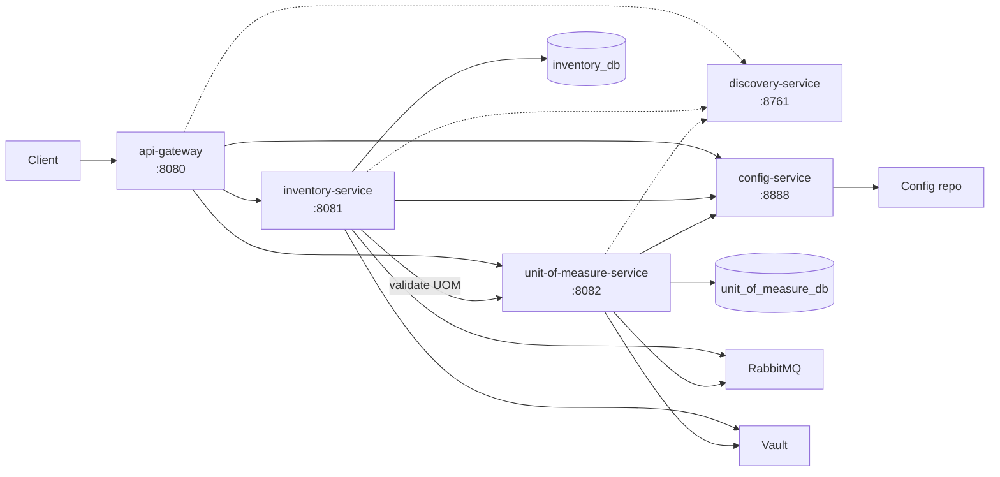

<p align="center">
  
</p>

<h1 align="center">Elara</h1>

<p align="center">
  <strong>A completed Spring Cloud reference platform for inventory and unit-of-measure management.</strong>
</p>

<p align="center">
  Java 21 · Spring Boot 3.5.6 · Spring Cloud 2025.0.0 · PostgreSQL · RabbitMQ · Vault · Docker Compose
</p>

<p align="center">
  <sub>Completed reference implementation · v1.3.1 · the published Compose stack is a demo, not a production deployment</sub>
</p>

<p align="center">
  <a href="#run-the-demo">Run the demo</a> ·
  <a href="#architecture">Architecture</a> ·
  <a href="#repositories">Repositories</a> ·
  <a href="https://bit.ly/4iznLgS">Final report</a>
</p>

## What is Elara?

Elara is a completed, runnable reference implementation of a Spring Cloud microservices platform. It models two business domains — inventory item master data and units of measure with their status catalog — and the platform services required to run them: an edge gateway, service discovery, centralized configuration, secret loading, health checks, a configuration-refresh bus and container orchestration.

The project is intentionally small enough to read end to end and complete enough to run as a system. It demonstrates service boundaries, synchronous service-to-service validation, per-service databases, externalized configuration, explicit error contracts, automated tests and a reproducible Docker Compose topology. The published Compose artifact is a demo for evaluation; the source stack is the reproducible build of the same system.

## What works today

| Area | Implemented |
|---|---|
| Inventory | Item CRUD, paginated list, case-insensitive name search, UOM existence validation, seed data (10 items) |
| Unit of measure | UOM CRUD, status CRUD, status assignment, usability changes, filtering, seed data (5 UOMs, 3 statuses) |
| Data | One PostgreSQL database per business service; no shared database |
| Edge | Gateway routing for `/api/v1/inventory/**` and `/api/v1/uom/**`, Swagger aggregation, access logging |
| Platform | Eureka discovery, Config Server + centralized configuration, Vault dev bootstrap (published inline; source profile-gated), RabbitMQ/Spring Cloud Bus, health checks |
| Delivery | Multi-stage Docker images, source and published Compose stacks, CI test/build workflows, OpenAPI/Swagger (spec paths and examples are hand-maintained; some are stale — live responses are authoritative) |

Both business APIs are implemented end to end. There is no frontend; Swagger UI is the interactive API surface.

## Architecture



`Config repo` is the `centralized-configuration` Git repository. All runtime services, both PostgreSQL instances, RabbitMQ and Vault are orchestrated by `infrastructure` through Docker Compose. The gateway is the client entry point; the source stack also publishes infrastructure ports for local inspection.

- **Database per service.** Inventory stores `baseUnitOfMeasureId` and validates it over HTTP against UOM; there is no cross-service foreign key.
- **Thin gateway.** Routing and Swagger aggregation live in `centralized-configuration`; the gateway code contains only the application entry point and the access-log filter.
- **Explicit routing.** Both gateway routes apply `StripPrefix=3`: `/api/v1/inventory/item/` maps to inventory's `/item/` controller and `/api/v1/uom/status/` maps to UOM's `/status/` controller. The bare `/api/v1/inventory/` prefix is not the collection path.
- **Externalized configuration.** Config Server serves profile files; clients own their bootstrap imports; Vault supplies dev credentials in the published demo, while the source stack exposes a profile-gated Vault loader.
- **Health-gated Compose.** Business services wait for config, discovery, their database, RabbitMQ and Vault; the gateway waits for the business services.

## Run the demo

Prerequisites: Docker Engine with Compose v2.30 or newer (the OCI demo reference requires it), and either `sudo` or membership in the `docker` group. `curl` and `jq` are useful for the checks below.

The published demo uses prebuilt images and starts the full stack:

```bash
export ELARA="oci://ghcr.io/elara-app/elara-demo:1.3.1"
sudo docker compose -f "$ELARA" up -d --wait --wait-timeout 900
```

To build from source, check out the five service repositories and `centralized-configuration` next to `infrastructure`, then point `ELARA` at the Compose file:

```bash
export ELARA="/absolute/path/to/infrastructure/compose.yml"
sudo docker compose -f "$ELARA" up -d --wait --wait-timeout 900
```

The source stack starts without the profile-gated Vault loader. To load the dev secrets explicitly, run `sudo docker compose -f "$ELARA" --profile bootstrap up vault-loader`.

Open Swagger UI at <http://127.0.0.1:8080/swagger-ui.html>. Verify the seeded data through the gateway:

```bash
curl -s http://127.0.0.1:8080/api/v1/inventory/item/ | jq '.page.totalElements'   # 10
curl -s http://127.0.0.1:8080/api/v1/uom/ | jq '.page.totalElements'            # 5
curl -s http://127.0.0.1:8080/api/v1/uom/status/ | jq '.page.totalElements'     # 3
```

Follow logs and stop the stack with:

```bash
sudo docker compose -f "$ELARA" logs -f
sudo docker compose -f "$ELARA" down
```

`down` removes the containers and the ephemeral PostgreSQL data and Vault secrets. Full commands, ports and troubleshooting are in the [infrastructure README](https://github.com/elara-app/infrastructure#readme).

## Repositories

| Repository | Responsibility | Type | Port |
|---|---|---|---|
| [`api-gateway`](https://github.com/elara-app/api-gateway) | Edge routing, Swagger aggregation, access logging | Runtime | 8080 |
| [`discovery-service`](https://github.com/elara-app/discovery-service) | Eureka service registry | Runtime | 8761 |
| [`config-service`](https://github.com/elara-app/config-service) | Spring Cloud Config Server | Runtime | 8888 |
| [`inventory-service`](https://github.com/elara-app/inventory-service) | Inventory item master data and UOM validation | Runtime | 8081 |
| [`unit-of-measure-service`](https://github.com/elara-app/unit-of-measure-service) | UOM catalog and status governance | Runtime | 8082 |
| [`centralized-configuration`](https://github.com/elara-app/centralized-configuration) | Versioned configuration and dev Vault bootstrap values | Support | — |
| [`infrastructure`](https://github.com/elara-app/infrastructure) | Compose orchestration, Vault/PostgreSQL bootstrap, release workflows | Support | — |
| [`.github`](https://github.com/elara-app/.github) | Organization profile, reusable CI workflows and historical automation | Meta | — |

The five runtime services are independent Maven/Spring Boot applications. `centralized-configuration` and `infrastructure` are support repositories; `.github` hosts the organization profile, the reusable CI workflows and the historical automation.

## Engineering standards

| Practice | Evidence |
|---|---|
| Layered service design | Controller → service → repository; DTOs and MapStruct; entities are not exposed |
| Validation and error contract | Jakarta Validation, global exception handlers and explicit error codes |
| API documentation | OpenAPI annotations and Swagger UI; aggregated docs through the gateway; checked-in paths and examples are hand-maintained and some are stale — live responses are authoritative |
| Testing and CI | Unit, controller, repository, mapper and exception tests; PR test workflows |
| Coverage gates | JaCoCo enforces 80% line, 70% branch and 0 missed classes for inventory and UOM |
| Container delivery | Multi-stage Dockerfiles, non-root UID 10001, healthchecks and bounded logs |
| Configuration and secrets | Config Server, centralized configuration, Vault dev bootstrap and RabbitMQ refresh |
| Operational contract | Health-gated Compose dependencies, explicit ports, seed data and two delivery modes |

Current suite: **379 tests** across the five services — 128 inventory, 229 unit-of-measure, 20 gateway, 1 discovery and 1 config. Evidence lives in the service `pom.xml` files, test suites and the [reusable test workflow](https://github.com/elara-app/.github/blob/main/.github/workflows/test-service.yml).

## Project status

- Completed reference implementation; both business domains are implemented end to end.
- Not production-hardened: no authentication, TLS, rate limiting, HA Eureka, persistence/backup or audit trail.
- Inventory is item master data only: no stock ledger, stock movements or purchasing.
- UOM usability is not enforced when a status is assigned; there is no audit log.
- Some OpenAPI spec paths and examples are hand-maintained and stale; live responses and controller tests are authoritative.
- The published Compose stack is a demo; PostgreSQL and Vault are ephemeral and `:latest` floats.
- Production profiles in `centralized-configuration` are sparse placeholders; schema management uses `ddl-auto`, not migrations.

## Documentation

| Document | Covers |
|---|---|
| [Inventory service](https://github.com/elara-app/inventory-service#readme) | API, data model, UOM integration and tests |
| [Unit of measure service](https://github.com/elara-app/unit-of-measure-service#readme) | UOM/status API, invariants and tests |
| [Infrastructure](https://github.com/elara-app/infrastructure#readme) | Quickstart, ports, source vs published, and troubleshooting |
| [Centralized configuration](https://github.com/elara-app/centralized-configuration#readme) | Profile matrix, property ownership and Vault paths |
| [Final written report](https://bit.ly/4iznLgS) | Full academic report on the architecture and engineering practices (Spanish PDF) |

## Maintainer

Designed and maintained by [@andresbetov](https://github.com/andresbetov). Issues and questions are welcome in the relevant repository.

## License

MIT. See the `LICENSE` file in each repository.
